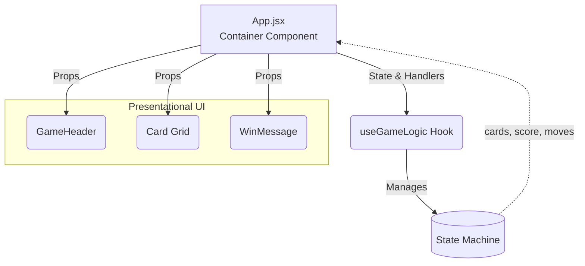

# React Memory Card Game

A modern, responsive memory-matching web application built with **React 19** and **Vite**. Features an adaptive reshuffling mechanic designed to challenge short-term spatial memory, implemented using clean component composition and a custom React hook for decoupled game state management.

[](https://react.dev/)
[](https://vite.dev/)
[](LICENSE)
[](https://eslint.org/)

---

## Table of Contents

- [Overview](#overview)
- [Key Features](#key-features)
- [System Architecture](#system-architecture)
- [Algorithmic Complexity](#algorithmic-complexity)
- [Comprehensive Code Walkthrough](#comprehensive-code-walkthrough)
  - [1. Presentation vs. Business Logic Separation](#1-presentation-vs-business-logic-separation)
  - [2. Game State Modeling](#2-game-state-modeling)
  - [3. The Shuffling Algorithm (Fisher-Yates)](#3-the-shuffling-algorithm-fisher-yates)
  - [4. Dynamic Reshuffle Strategy](#4-dynamic-reshuffle-strategy)
  - [5. Race Condition & Click Guarding (`isLocked`)](#5-race-condition--click-guarding-islocked)
  - [6. Evaluation & Transition Timeline](#6-evaluation--transition-timeline)
- [Common Interview Questions & Answers](#common-interview-questions--answers)
- [Tech Stack](#tech-stack)
- [Project Directory Structure](#project-directory-structure)
- [Getting Started](#getting-started)
- [Available Scripts](#available-scripts)
- [Future Enhancements & Scalability](#future-enhancements--scalability)
- [Author & License](#author--license)

---

## Overview

Traditional memory card games rely on memorizing static grid positions. This implementation introduces a dynamic twist: **all unmatched cards dynamically reshuffle their board coordinates after each turn**, while solved pairs stay locked in place.

This requires players to maintain an active mental model of which cards remain hidden versus which have been cleared, significantly elevating difficulty and engagement.

> **Note to Interviewers:** This project demonstrates proficiency in React 19 hooks, state machine design, handling asynchronous race conditions, and applying optimal algorithms (Fisher-Yates) in a UI context.

---

## Key Features

- **4x4 Dynamic Board (16 Cards):** 8 unique pairs of distinct visual values.
- **Adaptive Shuffle Mechanic:** Unmatched cards change positions after every turn; matched pairs remain pinned.
- **Real-Time Metrics:** Live tracking of matches made (`score`) and total attempts (`moves`).
- **Game Completion Detection:** Deterministic win condition triggered when all pairs are resolved, presenting summary statistics.
- **State Reset Capability:** Clean teardown and reinitialization of board state without page reloads.
- **CSS 3D Hardware-Accelerated Animation:** True 3D card flips with `perspective`, `transform-style: preserve-3d`, and `backface-visibility`.
- **Responsive Layout:** CSS Grid architecture adapting seamlessly from mobile viewports to desktop displays.

---

## System Architecture

The project follows the **Container / Presentational Component Pattern** alongside a **Custom Hook (`useGameLogic`)** that serves as a self-contained state machine.



---

## Algorithmic Complexity

The game is highly optimized, ensuring smooth 60fps rendering even during state transitions.

| Operation | Time Complexity | Space Complexity | Description |
|---|---|---|---|
| **Deck Initialization** | **$O(N)$** | **$O(N)$** | Maps and shuffles the initial card array. |
| **Fisher-Yates Shuffle** | **$O(N)$** | **$O(N)$** | Linear time, unbiased uniform permutation. |
| **Partial Board Reshuffle** | **$O(N)$** | **$O(N)$** | Filters unmatched cards, shuffles, and maps them back. |
| **Card Click Event** | **$O(N)$** | **$O(N)$** | Evaluates matches and triggers reshuffles. |

*(Where $N$ is the total number of cards on the board, currently $N = 16$. Because $N$ is small, all operations run in effectively constant time $O(1)$, but scale linearly $O(N)$.)*

---

## Comprehensive Code Walkthrough

Use this section to articulate the architecture and engineering decisions during technical interviews.

### 1. Presentation vs. Business Logic Separation

- **`App.jsx`:** Functions strictly as an orchestration container. It receives state and handler functions from `useGameLogic` and passes them down as props. It contains no state manipulation or arithmetic logic.
- **`src/components/`:** Pure presentational components (`GameHeader`, `Card`, `WinMessage`). They are stateless and depend entirely on received props, maximizing predictability and making them easy to unit test.
- **`src/hooks/useGameLogic.js`:** Encapsulates the entire domain logic (card generation, deck shuffling, turn resolution, match verification, and delay timers).

### 2. Game State Modeling

Inside `useGameLogic.js`, state is structured into atomic primitives to prevent redundant calculations and unnecessary re-renders:

```javascript
const [cards, setCards] = useState([]);             // Array of 16 card objects
const [flippedCards, setFlippedCards] = useState([]); // IDs of currently opened cards (max length: 2)
const [matchedCards, setMatchedCards] = useState([]); // Array of solved card IDs
const [score, setScore] = useState(0);              // Number of successful pairs matched
const [moves, setMoves] = useState(0);              // Total number of turn attempts
const [isLocked, setIsLocked] = useState(false);    // Concurrency guard during async delays
```

Each card entity in the `cards` array conforms to:
```typescript
interface Card {
  id: number;          // Unique position index
  value: string;       // Card content identifier (e.g., fruit symbol or icon)
  isFlipped: boolean;  // Controls active card front/back rotation
  isMatched: boolean;  // Flags completed state (glow style & interaction lock)
}
```

### 3. The Shuffling Algorithm (Fisher-Yates)

Rather than using the common but flawed `array.sort(() => Math.random() - 0.5)` pattern, the application uses the **Durstenfeld modern variant of the Fisher-Yates shuffle**:

```javascript
const shuffleArray = (array) => {
    const shuffled = [...array];
    for (let i = shuffled.length - 1; i > 0; i--) {
        const j = Math.floor(Math.random() * (i + 1));
        [shuffled[i], shuffled[j]] = [shuffled[j], shuffled[i]];
    }
    return shuffled;
};
```

**Why this matters in an interview:**
- `Math.random() - 0.5` with `.sort()` produces **non-uniform distribution** (bias) because sorting algorithms (like Timsort or Quicksort) do not compare every element with equal probability.
- Fisher-Yates guarantees an **unbiased, uniform permutation** with **$O(n)$ time complexity** and **$O(n)$ space complexity**.

### 4. Dynamic Reshuffle Strategy

When unmatched cards are swapped, already-matched cards must remain in their original positions.

```javascript
const shuffleUnmatchedCards = (currentCards) => {
    const unmatchedIndices = [];
    const unmatchedCards = [];

    // Step 1: Filter out matched cards and identify available slots
    currentCards.forEach((card, index) => {
        if (!card.isMatched) {
            unmatchedIndices.push(index);
            unmatchedCards.push(card);
        }
    });

    // Step 2: Randomly permute only the unmatched entities
    const shuffledUnmatched = shuffleArray(unmatchedCards);
    const newCardsArray = [...currentCards];

    // Step 3: Map shuffled items back into the reserved indices
    unmatchedIndices.forEach((index, i) => {
        newCardsArray[index] = shuffledUnmatched[i];
    });

    return newCardsArray;
};
```

**Key Takeaway:** This preserves array stability without disrupting matched card layout or triggering unnecessary DOM reconstructs.

### 5. Race Condition & Click Guarding (`isLocked`)

A critical challenge in interactive UI games is handling rapid user clicks while card animations or evaluations are pending.

```javascript
const handleClick = (card) => {
    if (
        card.isFlipped ||
        card.isMatched ||
        isLocked ||
        flippedCards.length === 2
    ) {
        return; // Guard clause prevents invalid transitions
    }
    // ...
}
```

**Guard Conditions Evaluated:**
1. `card.isFlipped`: Prevents double-clicking the same card twice.
2. `card.isMatched`: Ignores clicks on already solved pairs.
3. `isLocked`: Blocks all board clicks while asynchronous timeouts are processing.
4. `flippedCards.length === 2`: Hard boundary ensuring no more than two cards can ever be revealed simultaneously.

### 6. Evaluation & Transition Timeline

When the second card is clicked (`newFlippedCards.length === 2`):

- **If Match (`firstCard.value === card.value`):**
  - Lock interaction: `setIsLocked(true)`.
  - Wait `500ms` (allows the player to visually register the match).
  - Update `isMatched: true` for both cards.
  - Increment score: `setScore(s => s + 1)`.
  - Reshuffle remaining unmatched cards via `shuffleUnmatchedCards()`.
  - Release lock: `setIsLocked(false)`.

- **If Mismatch (`firstCard.value !== card.value`):**
  - Lock interaction: `setIsLocked(true)`.
  - Wait `700ms` for viewing.
  - Flip cards back face down (`isFlipped: false`).
  - Stagger delay `300ms` later: reshuffle unmatched cards.
  - Release lock: `setIsLocked(false)`.

---

## Common Interview Questions & Answers

### Q1: Why separate logic into a Custom Hook instead of keeping it in `App.jsx`?
> **Answer:** Decoupling logic into `useGameLogic` enforces the **Single Responsibility Principle (SRP)**. `App.jsx` only concerns itself with rendering and layout structure, while `useGameLogic` handles state transitions. This also allows the game engine to be reused in another interface (e.g., React Native or a CLI) without changing core rules.

### Q2: What issue occurs with `array.sort(() => Math.random() - 0.5)`?
> **Answer:** In V8 and JavaScript engines, `.sort()` uses Timsort. Passing non-transitive comparison functions (where $A > B$ and $B > C$ doesn't mean $A > C$) violates the sorting invariant, resulting in uneven probabilities across different positions. The Fisher-Yates algorithm guarantees true uniform randomness in linear $O(n)$ time.

### Q3: How are asynchronous race conditions handled in React state updates?
> **Answer:** Using the `isLocked` boolean guard in conjunction with **functional state updater callbacks** (e.g., `setCards(prev => ...)`). Functional updates avoid stale closure bugs inside `setTimeout`, ensuring the component always mutates the freshest snapshot of state.

### Q4: How would you scale this game for larger boards (e.g., 100 cards)?
> **Answer:**
> 1. Wrap individual `<Card />` components with `React.memo` and define stable callback references with `useCallback` to prevent re-rendering cards whose state hasn't changed.
> 2. Implement CSS virtualized grid rendering if viewport scrolling is required.
> 3. Move the card position reshuffle calculation to a Web Worker if array sizes become large enough to block the main thread.

---

## Tech Stack

| Layer | Tool / Library | Reason Selected |
|---|---|---|
| **Frontend Framework** | **React 19** | Functional components, Hooks, concurrent rendering |
| **Tooling & Bundler** | **Vite 7** | Sub-second HMR, Rollup-optimized production builds |
| **Styling** | **Vanilla CSS3** | Custom 3D perspective transforms, CSS Grid, zero overhead |
| **Linter** | **ESLint 9** | Enforces code formatting standards and React best practices |

---

## Project Directory Structure

```text
react-memory-game/
├── public/                 # Static assets
├── src/
│   ├── components/
│   │   ├── Card.jsx        # Flippable 3D card item (stateless)
│   │   ├── GameHeader.jsx  # Scoreboard, moves counter, and reset trigger
│   │   └── WinMessage.jsx  # Victory banner modal (shown on completion)
│   ├── hooks/
│   │   └── useGameLogic.js # Core game engine (state, shuffles, timers)
│   ├── App.jsx             # Main application orchestrator
│   ├── index.css           # Global stylesheet & design tokens
│   └── main.jsx            # React root DOM mount point
├── index.html              # HTML shell
├── package.json            # Project dependencies and script declarations
├── vite.config.js          # Vite build configuration
└── README.md               # Technical project documentation
```

---

## Getting Started

### Prerequisites

- **Node.js** (v18.0.0 or later recommended)
- **npm** (v9.0.0 or later)

Verify environment readiness:
```bash
node -v
npm -v
```

### Installation & Run

1. **Clone the repository:**
   ```bash
   git clone https://github.com/Rohan-Bhandari162/react-memory-game.git
   cd react-memory-game
   ```

2. **Install dependencies:**
   ```bash
   npm install
   ```

3. **Start local development server:**
   ```bash
   npm run dev
   ```
   Open your browser and navigate to the printed local port (defaults to `http://localhost:5173`).

---

## Available Scripts

| Command | Action |
|---|---|
| `npm run dev` | Starts the Vite development server with Hot Module Replacement (HMR). |
| `npm run build` | Compiles and tree-shakes production assets into `/dist`. |
| `npm run preview` | Serves the production build locally for verification. |
| `npm run lint` | Runs ESLint to check for syntax and style issues. |

---

## Future Enhancements & Scalability

- [ ] **Persistent Leaderboard:** Utilize `localStorage` or IndexedDB to record best scores and fastest clearing times.
- [ ] **Countdown / Speedrun Timer:** Introduce time-pressure modes.
- [ ] **Configurable Board Dimensions:** Support dynamic grid configurations (3x4, 4x4, 6x6).
- [ ] **Sound Effects Web Audio API:** Audio synthesizer integration for flip, match, and completion feedback.
- [ ] **Unit & Component Testing:** Add Vitest and React Testing Library to write regression tests for `useGameLogic`.

---

## Author & License

- **Author:** Rohan Bhandari
- **Repository:** [react-memory-game](https://github.com/Rohan-Bhandari162/react-memory-game)
- **License:** Distributed under the [MIT License](LICENSE).
